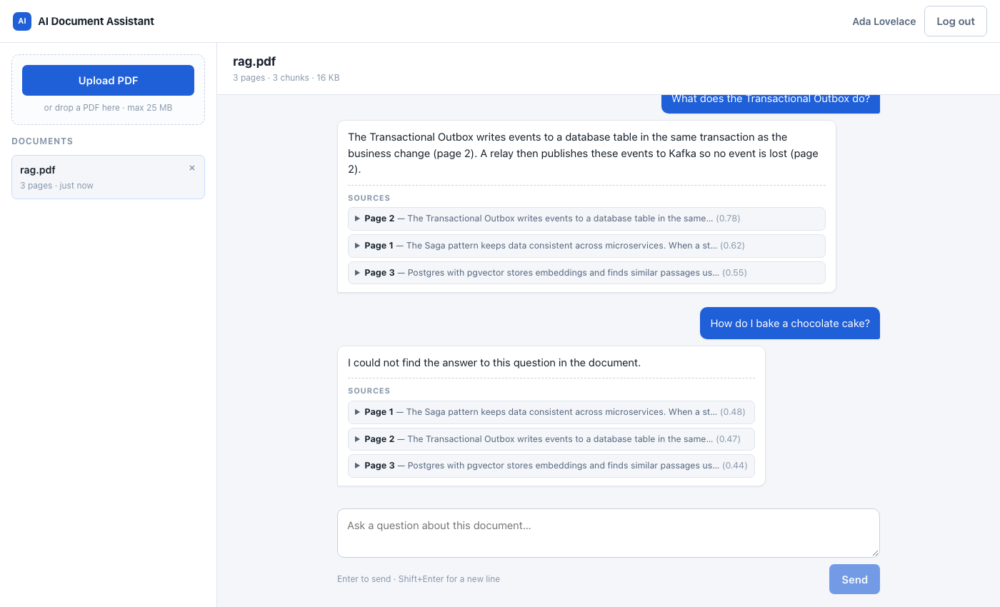

# AI Document Assistant

[](https://github.com/besko2002/ai-document-assistant/actions/workflows/ci.yml)

Upload a PDF and ask questions about it in a chat. Answers are **grounded in your document** (Retrieval-Augmented Generation) and **cite the pages** they came from. If the document does not contain the answer, the assistant says so instead of inventing one.

A full-stack project: **Spring Boot + PostgreSQL/pgvector** backend, **React + TypeScript** frontend, Google **Gemini** for embeddings and answers.



## How it works

```
 PDF ──► extract text per page ──► split into overlapping chunks ──► embed each chunk (Gemini)
                                                                          │
                                                          stored as vectors in PostgreSQL (pgvector)
                                                                          │
 Question ──► embed (Gemini) ──► nearest chunks of that document (cosine) ┘
                                          │
                  chunks + question ──► Gemini ──► answer with page citations
```

1. **Upload** – PDFBox extracts the text page by page; it is split into ~1000-character chunks with overlap, each keeping its page number.
2. **Embed** – every chunk becomes a 768-dimension vector (`gemini-embedding-001`) stored in a pgvector `vector(768)` column with an HNSW cosine index.
3. **Ask** – the question is embedded, the 5 closest chunks of *that document* are retrieved, and the model answers using only those excerpts.
4. **Cite** – the response includes the source pages, snippets and similarity scores; the UI shows them as collapsible cards.

## Features

- Register / log in (JWT, BCrypt). Every document and conversation belongs to its owner; another user's document is a `404`, so ids do not leak.
- PDF upload with validation (magic bytes, page cap, no scanned/image-only PDFs, size limit) and delete.
- Conversation history per document.
- **Prompt-injection hardening** – document text is fenced inside `<excerpts>` and the model is told it is untrusted data, never instructions.
- **Resilient AI calls** – the free Gemini tier is sometimes rate-limited (`429`) or briefly overloaded (`503`): chat retries a few times, then falls back to **Groq** if `GROQ_API_KEY` is set. Embeddings retry with backoff, and an upload is saved only if every chunk embedded successfully.
- Consistent JSON errors; Swagger UI at `/swagger-ui.html`.

## Tech stack

Java 21 · Spring Boot 3.5 · Spring Security (JWT/HS256) · Spring Data JPA · Flyway · PostgreSQL 16 + **pgvector** · Apache PDFBox · springdoc-openapi · Testcontainers ·
React 18 · TypeScript · Vite · Vitest + Testing Library · nginx · Docker Compose · GitHub Actions

## Run it

You need Docker and a free Gemini API key from [Google AI Studio](https://aistudio.google.com/app/apikey) (no credit card).

```bash
cp .env.example .env.local        # then put your key in GEMINI_API_KEY
docker compose --env-file .env.local --profile app up -d --build
```

Open **http://localhost:5174**, create an account, upload a PDF and ask away.

**Development mode** (Postgres in Docker, apps on your machine):

```bash
docker compose up -d --wait                       # PostgreSQL + pgvector on :5436
set -a; . ./.env.local; set +a
./mvnw spring-boot:run                            # API on :8090  (Swagger: /swagger-ui.html)
cd frontend && npm install && npm run dev         # UI on :5174, proxies /api to :8090
```

| What | Where |
|---|---|
| App | http://localhost:5174 |
| API / Swagger | http://localhost:8090 · `/swagger-ui.html` |
| PostgreSQL | `localhost:5436` (`doc` / `doc`) |

## API

| Method & path | Auth |
|---|---|
| `POST /api/auth/register`, `POST /api/auth/login` | public |
| `GET /api/auth/me` | user |
| `POST /api/documents` (multipart `file`) | user |
| `GET /api/documents`, `GET /api/documents/{id}`, `DELETE /api/documents/{id}` | owner |
| `POST /api/documents/{id}/ask` `{ "question": "…" }` | owner |
| `GET /api/documents/{id}/messages` | owner |

## Tests

```bash
./mvnw verify                      # backend: unit + integration on real PostgreSQL/pgvector (Docker needed)
cd frontend && npm test -- --run   # frontend
```

The backend integration tests exercise the real upload → chunk → pgvector search → prompt path. The AI providers are **faked** there (a word-hash embedding, a stubbed chat model), so the tests are deterministic and use no API quota. The real Gemini calls are covered by mock-server unit tests and were checked by hand end to end.

## Known limitations

- Scanned or image-only PDFs are rejected (there is no OCR).
- Retrieval uses the 5 closest chunks, so questions that need the *whole* document (for example "summarise it") answer from those chunks only.
- The default `JWT_SECRET` is for local development; set your own for any real deployment.
- The Groq fallback is implemented and unit-tested against a mock, but has not been tried against the real Groq API.
